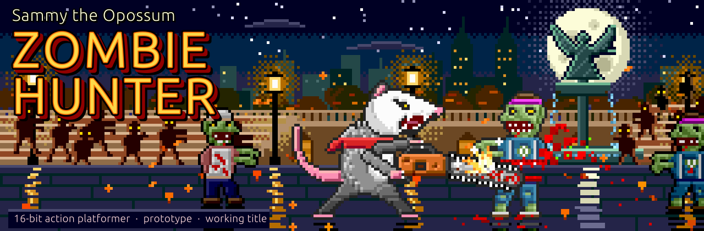
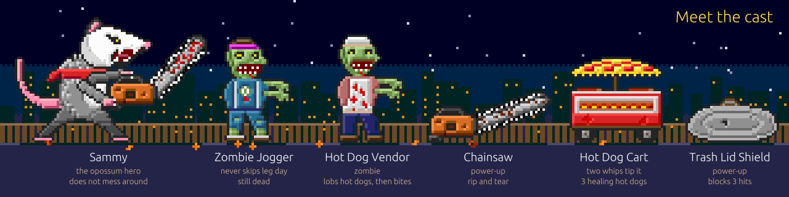
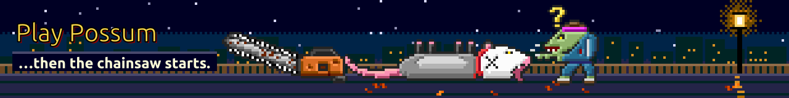

<p align="center"></p>

# Sammy

**Sammy** is a small 2D platformer in the style of a 16-bit home console game. You play Sammy, an opossum who wakes up in Central Park with no memory of how he got there. Everyone in the city has turned into a zombie. Sammy fights his way through with his tail, a trash-can lid, a tipped-over hot dog cart, and his secret move: playing dead. The zombies are funny, not scary: heads pop off and bounce, and vendors deflate like balloons.

> [!NOTE]
> **Status: playable placeholder prototype.** One level (level 1, Sheep Meadow) can be played from start to finish today. Almost all art is placeholder boxes and all sound is computer-made beeps. The first real art is in: **Sammy's run animation**. "Sammy" is a working title.

Every gameplay number and rule in the game is a **proposal**, not an approved decision. They can all be changed.

## I want to…

| I want to… | Go here |
|---|---|
| Play the game | [Play it now](#play-it-now) |
| Add art | [Adding real art](#adding-real-art) |
| Add sound | [Adding sound](#adding-sound) |
| See what's still missing | Run the scanner: [Adding real art, step 1](#adding-real-art) |
| Change a game number (speed, damage, timings) | [game/src/config.js](game/src/config.js) |
| See everything waiting on me | [design/OPEN_TASKS.md](design/OPEN_TASKS.md) |
| See the open questions | [design/OWNER_DECISIONS.md](design/OWNER_DECISIONS.md) |
| Get a blank drawing template | [templates/art-templates/](templates/art-templates/) and [design/ART_BRIEFS.md](design/ART_BRIEFS.md) |
| See what changed | [design/DECISIONS.md](design/DECISIONS.md) |
| Share the game | [Building a shareable copy](#building-a-shareable-copy) (`game/dist/`) |

The same game page works on desktop and on phones and tablets (with touch buttons). Phones can only open it once it's on a website (not done yet), and nobody has tried it on a real phone yet.

## Contents

- [I want to…](#i-want-to)
- [Play it now](#play-it-now)
- [Controls](#controls)
- [What's in level 1](#whats-in-level-1)
- [Meet the cast](#meet-the-cast)
- [Project status and roadmap](#project-status-and-roadmap)
- [How the project is organized](#how-the-project-is-organized)
- [Adding real art](#adding-real-art)
- [Adding sound](#adding-sound)
- [Building a shareable copy](#building-a-shareable-copy)
- [Tests](#tests)
- [Design docs map](#design-docs-map)
- [Art and licensing rules](#art-and-licensing-rules)
- [Credits](#credits)

---

## Play it now

1. On GitHub, click the green **Code** button, then **Download ZIP**, and unzip it. (Developers can use `git clone` instead.)
2. Double-click **`game/index.html`**. It opens in your web browser and the game starts.

That's it. There is nothing to install and no internet connection is needed. The ready-to-share copy, **`game/dist/index.html`**, works the same way.

**If your browser refuses to open local files,** start a tiny local web server instead. Open Terminal, go to the project folder, and run:

```sh
python3 -m http.server 8000
```

Then open <http://localhost:8000/game/> in your browser.

"The project folder" means the `opossum-game-library` folder. In Terminal, type `cd ` (with a space), drag the folder onto the window and press Enter. Every command on this page starts from there.

**Browsers:** the game is tested automatically in Chromium (the engine behind Chrome and Edge). It should also run in Safari and Firefox, but those have not been tested yet.

The game draws at 320×224 pixels, like a classic console, and scales up by whole numbers (×2, ×3, ×4 and so on) to fill the window, so pixels stay sharp. The steps count the screen's real pixels, so phones and tablets (which pack 2–3 real pixels into each point) get a much bigger picture than before, and every game pixel is still a clean square.

## Controls

| Action | Keyboard | Gamepad (standard layout) | Touch (phones and tablets) |
|---|---|---|---|
| Move | ← → or A D | D-pad (the cross-shaped direction pad) left/right, or left stick | Arrow pad, bottom left (slide your thumb across to turn round) |
| Jump (hold for a higher jump) | Z, Space, ↑, W or K | A / Cross, or D-pad up | Green JUMP button, bottom right |
| Tail-whip | X or J | X / Square | Red WHIP button |
| Play Possum (play dead) | C or L | B / Circle or Y / Triangle | Pink POSSUM button |
| Pause / start | Enter, Esc or P | Start | Blue pause button (‖); JUMP or a tap on the picture starts the game |
| Restart the level | R | Select / Back | RESTART (shown while paused) |
| Mute | M | — | MUTE (shown while paused) |

(Down is read too, but nothing uses it yet.)

Gamepads have not been tested by a real person yet.

**Phones and tablets:** looking great and playing well on mobile as well as desktop is a **major priority**. Two steps are done: the game is bigger and sharper on phones and tablets (held sideways, in our checks it fills 90–95% of an iPhone's height instead of under 60%; with the touch buttons on, iPhones with a notch get a picture one step smaller, about 76% of the height, to make room for them), and it now has **on-screen touch buttons**. They appear only on touch screens, never on a normal computer. Sideways, they sit in the black space beside the picture and may just cover the brown dirt strip at its bottom corners (never the top bar or the grass where Sammy and the zombies walk); upright, below it. The whole level can be played by touch in our automatic checks, but **nobody has tried it on a real phone yet**, and phones still need the game put on a website to open it. See the roadmap below.

## What's in level 1

Level 1, **Sheep Meadow**, is 12 screens long. A fast run takes about 1 minute; a first try takes about 3–5 minutes.

- **Tutorial:** on-screen prompts teach moving, jumping and the tail-whip.
- **Zombie joggers** patrol, spot Sammy, chase him and lunge. Two tail-whips defeat one, and its head pops off and bounces away.
- **Trash lid shield** blocks 3 hits.
- **Hot dog cart and vendor:** whip the cart twice to tip it over. It spills 3 healing hot dogs and knocks nearby zombies back. The vendor zombie throws hot dogs.
- **Play Possum:** Sammy plays dead for up to 3 seconds and nearby zombies get confused. It then needs 6 seconds to recharge.
- **A pond** to fall into (costs 1 heart), lampposts with hidden hot dogs on top, and **two checkpoints**.
- **The gauntlet:** at the end, the screen locks and 3 waves of joggers arrive (2, then 3, then 4). Beat them all to open the park exit and see your score tally.

Sammy has 3 hearts. Losing them all (a K.O.) sends him back to the last checkpoint with full health. There are no lives in this version.

For the full screen-by-screen guide, see **[game/README.md](game/README.md)**.

## Meet the cast

<p align="center"></p>

| Who or what | What it does in the game |
|---|---|
| **Sammy** | The opossum hero. Runs, jumps, tail-whips and plays possum. |
| **Zombie Jogger** | The main enemy. Patrols, chases Sammy and lunges at him. Two whips knock its head off. |
| **Hot Dog Vendor** | A zombie that lobs hot dogs at Sammy from a distance. Deflates when defeated. |
| **Hot Dog Cart** | Whip it twice to tip it. It spills 3 hot dogs that heal Sammy, and knocks zombies back. |
| **Trash Lid Shield** | A power-up. Once Sammy picks it up, it blocks the next 3 hits from zombies or thrown hot dogs. It doesn't help if he falls in the pond. |

These drawings were made for this page only. They are not the game's art. In the game itself, everyone is still a placeholder box, except Sammy while he runs (his real run animation).

## Project status and roadmap

**Done:**
- A complete, playable level 1 with placeholder art and sound.
- The first real art: **Sammy's run animation**.
- Bigger, sharper scaling on phones and tablets, and **on-screen touch buttons** (shown only on touch screens).
- An automatic art and sound loader: put a correctly named file into `assets/`, run the scanner, and it replaces its placeholder.
- Checks for art files (size, colors, see-through pixels).
- A shareable build (`game/dist/`: the game page plus an `assets/` folder with the cleared real art) with license rules and a credits list.
- Automatic game-rule tests and browser checks (see [Tests](#tests)).
- Design docs, templates and worked examples for every kind of art and sound.

**Next:**
1. **Desktop and mobile (major priority):** the game now fills phone and tablet screens crisply, and has on-screen touch buttons (both done). Still to do: the phone layout (a "turn your phone sideways" message, full screen, notches), and tests on real phones. The plan is in [design/DECISIONS.md](design/DECISIONS.md).
2. **You (the owner) answer the open questions** in **[design/OWNER_DECISIONS.md](design/OWNER_DECISIONS.md)**. There are 19, each with a suggested answer. The short version is in **[design/OPEN_TASKS.md](design/OPEN_TASKS.md)**. Examples: the final title, how gory it gets, who makes the art and music, and what goes in the first release.
3. You review the draft style guide, [design/STYLE_GUIDE.md](design/STYLE_GUIDE.md).
4. Real art and sound arrive, starting with the most important files ("Tier 1") in [design/ASSET_REQUEST_CHECKLIST.md](design/ASSET_REQUEST_CHECKLIST.md).
5. A playtest by real people, mainly of the final gauntlet. It may be too hard.

There is no release date. Publishing (for example on itch.io) has not been done and needs your go-ahead.

## How the project is organized

```
opossum-game-library/
├── README.md            ← this page
├── CLAUDE.md            ← working notes for Claude Code (the AI helper)
├── game/                ← the game itself
│   ├── index.html       ← double-click to play
│   ├── README.md        ← detailed game guide
│   ├── src/             ← the game's code (rules, drawing, sound, controls, level layout)
│   ├── tools/           ← build, art/sound scanner, audio converter, license rules, drawing-template maker
│   ├── tests/           ← automatic checks
│   └── dist/            ← ready-to-share copy (index.html, BUILD_INFO.txt, CREDITS.txt and an assets/ folder with the cleared real art)
├── assets/              ← real art and sound go here (so far only Sammy's run animation)
│   ├── characters/  enemies/  props/  items/  environments/  npcs/  ui/
│   ├── audio/           ← sfx/ (sound effects) and music/
│   └── references/      ← reference pictures only; never shipped
├── design/              ← game brief, owner questions, decisions log, style guide, asset checklist, license list
├── templates/           ← blank forms for describing art, sound, levels and abilities
│   ├── art-templates/   ← blank drawing templates (exact size, with guide marks) and contact sheets
│   └── examples/        ← planning specs for every planned file (proposals only)
└── .github/readme/      ← the artwork on this page
```

The game uses no game engine and no add-on packages. It is plain web-page code (HTML5 canvas and JavaScript), which is why double-clicking works. The reasons are in [design/DECISIONS.md](design/DECISIONS.md).

## Adding real art

1. **See what's missing.** From the project folder, run the scanner:
   ```sh
   cd game
   node tools/scan-assets.mjs
   ```
   Under **"Still missing — art"** it lists every planned picture that has no real file yet, by folder, with its exact file name and size in pixels. For example, under `assets/characters/character-sammy/` you'll see `sammy-idle-strip-v01.png  192×48`.
2. **Optional: start from a template.** `templates/art-templates/` has a see-through PNG for each planned picture, at the exact size, with faint guide marks (frame edges, feet point, ground line). Draw over it, **erase every guide mark**, and save it under the real name. [design/ART_BRIEFS.md](design/ART_BRIEFS.md) says what each picture should show and what the guide colours mean. To make the templates again: `node tools/make-art-templates.mjs` (from the `game` folder).
3. Save the PNG in that folder, with that exact name and size.
4. Add a row for it to `design/ASSET_SOURCES.csv` (who made it and its license; see [Art and licensing rules](#art-and-licensing-rules)). You can leave this until you want to share the game: the build then prints a ready-to-paste row for any file that has none (see [Building a shareable copy](#building-a-shareable-copy)).
5. Run the scanner again (same command). It lists what it found and warns about problems.
6. Reload the game. Every picture with a real file uses it. Everything else stays a placeholder.

You don't need the build to see new art in your own copy. Run `node tools/build.mjs` only when you want to refresh the shareable copy in `game/dist/`.

**Good to know:**
- **Versions:** to update a picture, save a new copy as `-v02`, `-v03` and so on beside the old one. The highest number wins.
- **Size check:** a file of the wrong size is **not** used, because it would be cut into frames wrongly. The placeholder stays and the title screen shows "ART WARNINGS".
- **Other warnings** (they never block a file): colors or see-through pixels that don't fit the 16-bit style, or too many colors in one file.
- **Shared folders:** a few files live in another thing's folder. The hot dog the vendor throws, and its splat, go in the vendor's folder; the hot dog pickup goes in the cart's folder. The scanner's list always shows the right folder.
- **Not shown yet:** some art the docs ask for has no place in the game yet, so adding it changes nothing on screen. The list is in [game/README.md → Adding art](game/README.md#adding-art).

More details (every scanner warning, frame sizes): **[game/README.md → Adding art](game/README.md#adding-art)**. What to send first: [design/ASSET_REQUEST_CHECKLIST.md](design/ASSET_REQUEST_CHECKLIST.md).

## Adding sound

1. **See what's missing.** From the project folder, run the scanner:
   ```sh
   cd game
   node tools/scan-assets.mjs
   ```
   Under **"Still missing — sounds"** it lists every planned sound that has no real file yet, with its exact path. Each sound has its own folder, named after the sound:
   - Sound effect: `assets/audio/sfx/sfx-jump/sfx-jump-v01.ogg`
   - Music: `assets/audio/music/music-level-01-central-park/music-level-01-central-park-v01.ogg`
2. Save the file at that path (`.mp3` or `.wav` instead of `.ogg` is also fine).
3. Add a row for it to `design/ASSET_SOURCES.csv`, just like art. The build prints a ready-to-paste row for you (see [Building a shareable copy](#building-a-shareable-copy)).
4. Run the scanner again (same command).
5. Reload the game and press a key (browsers stay silent until you do). Each sound with a real file uses it; the rest keep their beep.

As with art, run `node tools/build.mjs` only when you want to refresh the shareable copy.

- **Formats:** `.ogg` is preferred. `.mp3` and `.wav` also work.
- **Only have WAV files?** From the project folder, run:
  ```sh
  cd game
  node tools/convert-audio.mjs
  ```
  It makes an `.ogg` next to each `.wav` that doesn't have one yet (add `--mp3` for `.mp3` copies too). It needs a free program called ffmpeg (on a Mac with Homebrew, a free installer for tools like this: `brew install ffmpeg`). It never deletes or overwrites anything. Without ffmpeg, it prints the exact commands to run instead.
- **Versions and variations:** to update a sound, save `sfx-jump-v02.ogg` beside `v01`; the highest number wins. For variety, save `sfx-land-v01-a.ogg`, `sfx-land-v01-b.ogg` and so on; the game picks one at random each time.
- **Music loops whole.** Each track plays from start to end, then starts over. A separate intro that plays only once is not supported yet, so make each track loop cleanly from its end back to its start.

More details (which format plays first, volume, when music restarts): **[game/README.md → Adding sound](game/README.md#adding-sound)**.

## Building a shareable copy

From the project folder, run:

```sh
cd game
node tools/build.mjs
```

This refreshes `game/dist/`. You only need it for the shareable copy; your own copy (`game/index.html`) picks up new files after the scanner runs.

| File | What it is |
|---|---|
| `index.html` | The game's code in one file. Cleared art and sound are copied into `dist/assets/` beside it (today: Sammy's run animation), so share the whole `dist/` folder. |
| `assets/` | The cleared real art and sound. |
| `BUILD_INFO.txt` | Which art and sound went in, and why any were left out. Its "Still placeholders (no real file yet):" section is your to-do list: every planned picture and sound that has no real file yet. |
| `CREDITS.txt` | A credit line for every included file whose license asks for one. |

**License rows to paste:** if a file has no row in `design/ASSET_SOURCES.csv`, the build says so near the top of what it prints, under "License rows missing in design/ASSET_SOURCES.csv (paste and check):", with one ready-to-paste row per file. Paste each row into that file, check every column, and run the build again. A new version (like `-v02`) gets a copy of the older version's row. A brand-new file gets blanks to fill in, and it stays out of the shareable copy until you do. The build never changes `ASSET_SOURCES.csv` itself.

**The license gate:** a file goes into the shareable copy only if its row in `design/ASSET_SOURCES.csv`:
- says `yes` under `commercial_use`, and
- names a license (not blank, "TBD" or "unknown"), and
- isn't a non-commercial ("NC") or reference-only license.

Anything else is left out, and `BUILD_INFO.txt` says why. Files in `assets/references/` are never included. Your own copy of the game still uses every file.

Today the only real art is Sammy's run animation (licensed in `design/ASSET_SOURCES.csv`, so it goes into the build); everything else is a placeholder. The `dist/` folder is saved in the project history for now (this is open question 9 in [design/OWNER_DECISIONS.md](design/OWNER_DECISIONS.md)).

## Tests

The tests need Node 18 or newer (a free program for running JavaScript). Nothing else to install. From the project folder, run:

```sh
cd game
node --test tests/sim.test.mjs
node tests/browser-smoke.mjs
```

| Command | What it checks |
|---|---|
| `node --test tests/sim.test.mjs` | **49 game-rule tests:** every move, enemy and item in level 1, a full autopilot run, the screen-size and touch-button maths, the art, sound and license checks, the "still missing" lists, the suggested license rows and the drawing templates. |
| `node tests/browser-smoke.mjs` | **33 browser checks:** opens the game in a hidden Chromium browser, plays the whole level in both the normal and the shareable copy, presses real keys, taps the real touch buttons at phone sizes, draws every screen, loads test art and sound, checks the picture is big and sharp at a phone size and a laptop size, and checks the touch buttons stay hidden on a computer. Needs Chrome, Edge or another Chromium browser. |
| `?test=full` | Open `game/index.html`, click the address bar, type `?test=full` at the very end and press Enter. The game then plays itself ("autopilot") so you can watch a full run. |

If you changed the game's code, run the build (see [Building a shareable copy](#building-a-shareable-copy)) before the browser check. Otherwise the check fails and asks you to run `node tools/build.mjs`.

**Not tested by machine:** how the controls feel, difficulty, gamepads, how the sound actually sounds, Safari, Firefox and phones. See [game/README.md → Tests](game/README.md#tests) for the full lists.

## Design docs map

| File | What it's for |
|---|---|
| [design/GAME_BRIEF.md](design/GAME_BRIEF.md) | The game idea. What you've confirmed, and what is still only proposed. |
| [design/OPEN_TASKS.md](design/OPEN_TASKS.md) | **Start here:** a short list of everything waiting on your answer or your go-ahead. |
| [design/OWNER_DECISIONS.md](design/OWNER_DECISIONS.md) | The open questions only you can answer, each with a suggested answer. |
| [design/ART_BRIEFS.md](design/ART_BRIEFS.md) | What every planned picture and sound should look and sound like, and how to use the drawing templates. All Proposed. |
| [design/DECISIONS.md](design/DECISIONS.md) | A dated log of every choice made so far. "Current state" is at the top. |
| [design/STYLE_GUIDE.md](design/STYLE_GUIDE.md) | Draft art and sound rules: sizes, colors, outlines, light. All Proposed. |
| [design/ASSET_REQUEST_CHECKLIST.md](design/ASSET_REQUEST_CHECKLIST.md) | What art and sound to send, in order of priority. |
| [design/ASSET_SOURCES.csv](design/ASSET_SOURCES.csv) | One row per art or sound file: who made it and its license. One row so far (Sammy's run). |
| [templates/](templates/) | Blank forms for describing art (`ASSET.md`), interactive objects (`INTERACTION.md`), sound (`AUDIO.md`), levels (`LEVEL.md`), abilities (`ABILITY.md`) and the style guide. |
| [templates/art-templates/](templates/art-templates/) | Blank, see-through drawing templates at the exact size of each planned picture, plus enlarged, labelled contact sheets (`contact-sheet-*.png`). Made by `game/tools/make-art-templates.mjs`. |
| [templates/examples/README.md](templates/examples/README.md) | Filled-in examples of every form, and the planning specs for every planned file. Proposals only. Run the scanner to see which files exist. |
| [game/README.md](game/README.md) | The detailed game guide: level walk-through, extra art and sound details, build, tests. |
| [CLAUDE.md](CLAUDE.md) | Technical notes for Claude Code. |

## Art and licensing rules

- **Original work only.** The game nods to 16-bit classics through feel, gameplay ideas, colors and humor. It never copies or traces sprites, music, sound effects, logos or characters from other games.
- **No "Sega" or "Genesis"** (or other company or console names) in the title, logo or branding.
- **References never ship.** Pictures in `assets/references/` are for inspiration only and are never put in the shareable copy.
- **Unknown rights can't ship.** Every art and sound file needs a row in `design/ASSET_SOURCES.csv`. If the license is missing, unknown, non-commercial or reference-only, the file stays out of the build.
- **Examples are planning specs.** Files in `templates/examples/` are proposals. Never copy an example into `assets/` until every TBD is filled in.

**License for this project's code:** no license chosen yet (all rights reserved).

## Credits

- The artwork on this page (banner, cast lineup and footer) is original pixel art made for this project.
- The lettering in that artwork uses the **Ubuntu** font (Light) by Dalton Maag, under the Ubuntu Font Licence. The letters were converted to outlines inside the pictures. (GitHub pages can't change fonts, so the font appears only in the artwork.)
- The game itself uses no outside art, sound, fonts or code today. Its letters come from a small placeholder font drawn in code.

<p align="center"></p>
